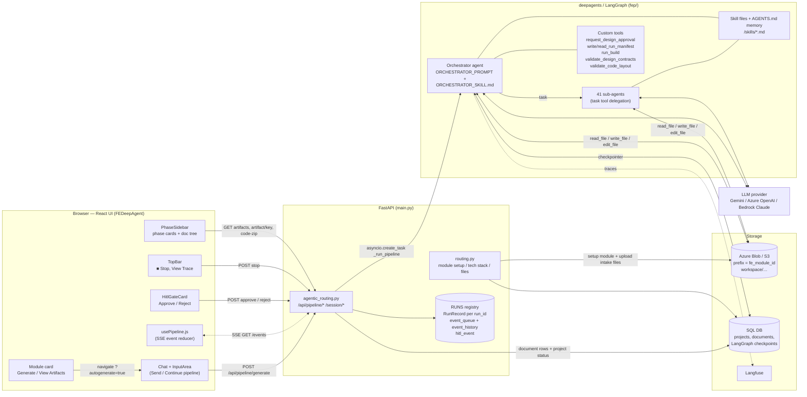
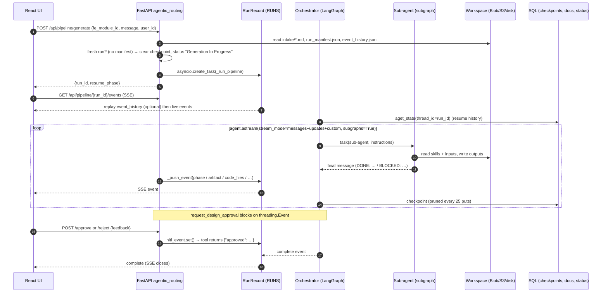

# Forward Engineering Pipeline (FEP) — Knowledge Transfer Document

Repos

- **Backend**: `ForwardEngineering/` (FastAPI + deepagents/LangGraph)
- **Frontend**: `CodeInsightAI-Frontend-Forgex/CodeInsightAI-UI-v2/` (React + Vite + MUI), feature folder `src/components/FEDeepAgent/`

---

## Table of contents

1. [What the application does](#1-what-the-application-does)
2. [Technology stack and frameworks](#2-technology-stack-and-frameworks)
3. [Architecture diagram](#3-architecture-diagram)
4. [Repo map — where things live](#4-repo-map--where-things-live)
5. [The agent system: orchestrator, sub-agents, skills](#5-the-agent-system-orchestrator-sub-agents-skills)
6. [How agents communicate](#6-how-agents-communicate)
7. [End-to-end flow, step by step (button → API → agent)](#7-end-to-end-flow-step-by-step-button--api--agent)
8. [Inputs per step and phase detail](#8-inputs-per-step-and-phase-detail)
9. [Auto-patch iteration reports (latest change)](#9-auto-patch-iteration-reports-latest-change)
10. [API reference](#10-api-reference)
11. [SSE event catalogue](#11-sse-event-catalogue)
12. [Techniques used to handle requests](#12-techniques-used-to-handle-requests)
13. [Storage, state and persistence](#13-storage-state-and-persistence)
14. [Configuration and environment](#14-configuration-and-environment)
15. [Debugging and operations cheat sheet](#15-debugging-and-operations-cheat-sheet)
16. [Known gotchas and caveats](#16-known-gotchas-and-caveats)

---

## 1. What the application does

**Input** (uploaded once, at module-creation time): a BRD, a target tech stack, and optionally a frontend tech stack, a legacy DB schema (optional), business/technical context and additional documents.

**Output**: a design trail and production-style code, produced by AI agents with a human approval gate:

```
BRD + tech stack (+ legacy DB schema, contexts, extra docs)
  → requirements.json                         Phase 0    requirements-analyst
  → DB schema report + migration SQL + ERD    Phase 0.5  db-schema-agent
  → SAD.md, HLD_<svc>.md, LLD_<svc>.md,
    design_contracts.json                     Phase 1    design-architect
  ── HUMAN GATE: approve / reject design ──
  → backend source tree (code/…)              Phase 2    8 codegen agents + tests
  → 3 review reports                          Phase 3    spec / quality / security reviewers
  → patched code + iteration reports          Phase 3.5  auto-patch (≤5 iterations)
  → comprehensive_review_report.md            Phase 4    comprehensive-code-reviewer
  → (≤1 remediation pass)                     Phase 4.5
  → build report / fixes                      Phase 5    build-agent / build-error-fixer
  → UI requirements, UI design  ── HUMAN GATE ──          Phase 6.0–6.1
  → UI source tree (ui/code/…), UI reviews,
    UI auto-patch, UI final review            Phase 6.2–6.5
  → packaged + launched dummy app (optional)  Phase 7    9 runner agents
```

Tested backend stacks (`fep/layout.py`): **Java/Spring (Maven), Node.js/TypeScript, .NET, Go, Python/FastAPI**. Supported architecture types: **monolithic** and **microservices**. UI stack is independent (React/Next.js with Tailwind, shadcn/ui, TanStack Query, Zustand, React Hook Form + Zod).

---

## 2. Technology stack and frameworks

### Backend

| Layer                       | Technology                                                                                                                                                                                                                                     | Where used                                           |
| --------------------------- | ---------------------------------------------------------------------------------------------------------------------------------------------------------------------------------------------------------------------------------------------- | ---------------------------------------------------- |
| Web framework               | **FastAPI** 0.120 (async)                                                                                                                                                                                                                | `main.py`, `routing.py`, `agentic_routing.py`  |
| Streaming to UI             | **sse-starlette** (`EventSourceResponse`)                                                                                                                                                                                              | `GET /api/pipeline/{run_id}/events`                |
| Agent framework             | **deepagents** 0.7.22 (`create_deep_agent`)                                                                                                                                                                                            | `fep/agent_builder.py`                             |
| Agent runtime / graph       | **LangGraph** 1.1.10, LangChain core                                                                                                                                                                                                     | orchestrator + sub-agent graphs, `astream`         |
| LLM providers               | `initialize_llm()` in `utils_factory/llm_config_factory.py`: **gemini** (default), **openai** (Azure OpenAI), **aws-bedrock-claude** (+ `-sso`), **azure-bedrock-claude-sso**; selected by `Config.LLM_OPTION` | `_run_pipeline`                                    |
| Conversation state          | Custom **`SQLCheckpointSaver`** (MS SQL / MySQL / Postgres)                                                                                                                                                                            | `fep/checkpointer.py`                              |
| Relational DB               | **SQLAlchemy 2** + **pyodbc** (Azure SQL)                                                                                                                                                                                          | `db/`, `models/`, project/module/document tables |
| File storage                | **Azure Blob** (`azure_blob_backend.py`) or **AWS S3** (`aws_s3_backend.py`) or local disk                                                                                                                                     | `_build_backend`                                   |
| Observability               | **Langfuse** 4.x (traces, `View Trace`)                                                                                                                                                                                                | `utils_langfuse.py`, `langfuse_instrumentation/` |
| Shell execution (Phase 5/7) | deepagents `LocalShellBackend` (`ENABLE_SHELL_BACKEND=true`)                                                                                                                                                                               | `_SanitizingShellBackend`                          |

## 3. Architecture diagram

### 3.1 System context



### 3.2 Agent hierarchy

```mermaid
flowchart TB
  O["ORCHESTRATOR<br/>(only agent that talks to the user)"]
  O --> P0["Phase 0: requirements-analyst"]
  O --> P05["Phase 0.5: db-schema-agent"]
  O --> P1["Phase 1: design-architect"]
  O --> G1{{"GATE: validate_design_contracts → request_design_approval"}}
  O --> P2["Phase 2: controllers · services · dtos · repositories<br/>entities · config · exceptions · middleware → then tests"]
  O --> G2{{"GATE: validate_code_layout"}}
  O --> P3["Phase 3: spec-compliance → code-quality → security reviewers"]
  O --> P35["Phase 3.5: auto-patch (≤5 iterations)"]
  O --> P4["Phase 4: comprehensive-code-reviewer<br/>(+ Phase 4.5 remediation, max once)"]
  O --> P5["Phase 5: build-agent ⇄ build-error-fixer (≤3 loops)"]
  O --> P6["Phase 6: ui-requirements-analyst → ui-architect → GATE →<br/>6 ui-*-generators → 3 ui reviewers → ui-auto-patch → ui-comprehensive-reviewer"]
  O --> P7["Phase 7: app-packager → dummy-profiler → service-launcher →<br/>gateway-runner → frontend-runner → seed-data → integration-tester<br/>(app-teardown on stop)"]
```



### 3.3 Run-time request sequence (one chat turn)



---

## 4. Repo map — where things live

### Backend (`ForwardEngineering/`)

| Path                                             | Purpose                                                                                                                                                                                                                      |
| ------------------------------------------------ | ---------------------------------------------------------------------------------------------------------------------------------------------------------------------------------------------------------------------------- |
| `main.py`                                      | FastAPI app, CORS, lifespan (`init_db`, Langfuse flush), mounts `routing.router` and `agentic_routing.router`                                                                                                          |
| `routing.py`                                   | **Module management** APIs: `POST /setup_application_fwd_engg_v2` (create module + upload BRD etc.), tech-stack / architecture / technical-context get+update, project files                                         |
| `agentic_routing.py`                           | **Pipeline** APIs + the run engine: `RunRecord`, `_run_pipeline`, SSE generator, artifact emission/dedup, HITL endpoints, code-zip                                                                                 |
| `fep/agent_builder.py`                         | `build_agent()` — defines the orchestrator and **all 41 sub-agents**; `_build_backend()` storage selection; `_SanitizingBackend` (strips `cat -n` line-number prefixes, path hardening); skill/memory seeding |
| `fep/prompts.py`                               | All system prompts: `ORCHESTRATOR_PROMPT`, per-phase prompts, review prompts, `AUTO_PATCH_PROMPT`, UI prompts, Phase 7 prompts; `specialise(text, stack)` makes prompts stack-specific                                 |
| `fep/skills/*.md`                              | **Skill files** (see §5.3). Copied into every run workspace at build time                                                                                                                                             |
| `fep/tools.py`                                 | Custom tools: HITL gate, manifest read/write, `run_build`, `validate_design_contracts`, `validate_code_layout`                                                                                                         |
| `fep/layout.py`                                | Stack registry (`STACKS`), directory layout rules, `seed_resolved_stack()` → `intake/resolved_stack.json`                                                                                                             |
| `fep/checkpointer.py`                          | Durable LangGraph checkpointer in SQL (+ pruning)                                                                                                                                                                            |
| `fep/memory_templates.py`                      | Loads skill/memory templates from `fep/skills/`                                                                                                                                                                            |
| `fep/build_scaffold.py`                        | Consolidates generated code into a buildable project for Phase 5/7                                                                                                                                                           |
| `utils_factory/`                               | `llm_config_factory.initialize_llm`, `database_factory`                                                                                                                                                                  |
| `azure_blob_backend.py`, `aws_s3_backend.py` | `BackendProtocol` implementations for cloud workspaces                                                                                                                                                                     |

### Frontend (`src/components/FEDeepAgent/`)

| File                                                                                                 | Purpose                                                                                                                                                                               |
| ---------------------------------------------------------------------------------------------------- | ------------------------------------------------------------------------------------------------------------------------------------------------------------------------------------- |
| `index.jsx`                                                                                        | Page shell; reads `?autogenerate=true`; file viewer; Download ZIP; wires Stop/Approve/Reject                                                                                        |
| `hooks/usePipeline.js`                                                                             | Central state machine: generate, SSE subscription, event handling, approve / reject / stop, refresh/restore                                                                           |
| `services/fepApi.js`                                                                               | API client: `generatePipeline`, `subscribeToEvents`, `approveDesign`, `rejectDesign`, `stopPipeline`, `fetchArtifact`, `fetchWorkspaceArtifacts`, `fetchCodeZipFiles` |
| `components/PhaseSidebar.jsx`                                                                      | Phase cards (`BACKEND_PHASES`, `UI_PHASES`, `APP_PHASES`), doc lists, folder trees (generated code, iteration reports)                                                          |
| `components/HitlGateCard.jsx`                                                                      | Approve / Reject UI                                                                                                                                                                   |
| `components/TopBar.jsx`                                                                            | Run status, **■ Stop** (with confirm), trace link                                                                                                                              |
| `components/InputArea.jsx`                                                                         | Chat box; **Send** / **Continue pipeline**                                                                                                                                |
| `components/ChatMessage.jsx`, `ArtifactCard.jsx`, `CodeFilesCard.jsx`, `CodegenProgress.jsx` | Rendering of messages, artifacts, code files, per-agent progress                                                                                                                      |
| `components/Modules/components/FEModuleCard.jsx`                                                   | The module card with the **Generate Artifacts / View Artifacts** button                                                                                                         |

---

## 5. The agent system: orchestrator, sub-agents, skills

### 5.1 Count at a glance

- **1 orchestrator** + **41 sub-agents** = 42 agents, all defined in `build_agent()` (`fep/agent_builder.py`), built with deepagents `create_deep_agent(model, system_prompt, backend, skills, memory, tools, checkpointer, subagents=[…])`.
- Sub-agents by group: Phase 0–1: **3** · Backend codegen: **8** + **tests** · Backend review: **3** · Auto-patch/final review: **2** · Build: **2** · UI requirements/design: **2** · UI codegen: **6** · UI review: **3** · UI patch/final: **2** · Phase 7 runner: **9** → **41**.

### 5.2 Agent catalogue

| #      | Agent                                                                                                                                                     | Phase                      | Task                                                                                                                | Main output                                                                                         | Inputs                                                                                                                                                                                                         |
| ------ | --------------------------------------------------------------------------------------------------------------------------------------------------------- | -------------------------- | ------------------------------------------------------------------------------------------------------------------- | --------------------------------------------------------------------------------------------------- | -------------------------------------------------------------------------------------------------------------------------------------------------------------------------------------------------------------- |
| 0      | `orchestrator`                                                                                                                                          | all                        | Classifies the request (STEP 0), sequences phases, enforces gates, writes manifest, answers questions               | `run_manifest.json`                                                                               | `/skills/ORCHESTRATOR_SKILL.md`, `/memory/AGENTS.md`, user message, `run_manifest.json`, checkpointed history, sub-agent replies                                                                         |
| 1      | `requirements-analyst`                                                                                                                                  | 0                          | Extract functional / non-functional requirements, services, out-of-scope items from BRD                             | `intake/requirements.json`                                                                        | `intake/brd.md`, `intake/tech_stack.md`; opt. `domain.txt`, `business_context.md`, `technical_context.md`, `backend_tech_stack.md`, `additional_documents.md`                                    |
| 2      | `db-schema-agent`                                                                                                                                       | 0.5                        | Migrate uploaded legacy schema **or** generate schema from BRD                                                | `design/db_schema/db_schema_report.json`, SQL, ERD                                                | `intake/requirements.json`, `intake/tech_stack.md`; opt. `db_schema_legacy.md`, `technical_context.md`, `additional_documents.md`                                                                    |
| 3      | `design-architect`                                                                                                                                      | 1                          | One continuous pass: `service_requirement_mapping.json` → SAD → per-service HLD → per-service LLD → contracts | `SAD.md`, `HLD_<svc>.md` (300+ lines), `LLD_<svc>.md` (400+ lines), `design_contracts.json` | `intake/requirements.json`, `intake/brd.md`, `intake/tech_stack.md`, `design/db_schema/db_schema_report.json`; opt. technical/business context, `additional_documents.md`                            |
| 4–11  | `controllers`, `services`, `dtos`, `repositories`, `entities`, `config`, `exceptions`, `middleware`                                       | 2                          | Each owns one **concern**; generates files for every contract with that `target_concern`                    | `code/…`                                                                                         | `design/design_contracts.json` (filtered by `target_concern`), `LLD_<svc>.md`, `HLD_<svc>.md`, `design/architecture_config.json`, `additional_documents.md`, BRD out-of-scope list                 |
| 12     | `tests`                                                                                                                                                 | 2                          | Runs **after** the 8 above; reads the real generated files, writes unit tests                                 | `code/tests/…`                                                                                   | same as concern agents **plus** the files the other 8 agents generated under `code/`                                                                                                                   |
| 13     | `spec-compliance-reviewer`                                                                                                                              | 3                          | Layer 1 — code matches `design_contracts.json`                                                                   | `reviews/spec_compliance_report.md`                                                               | `design_contracts.json`, `code/`, `additional_documents.md`                                                                                                                                              |
| 14     | `code-quality-reviewer`                                                                                                                                 | 3                          | Layer 2 — idiom, duplication, error handling, SoC                                                                  | `reviews/code_quality_report.md`                                                                  | `design_contracts.json`, `code/`, `additional_documents.md`                                                                                                                                              |
| 15     | `security-reviewer`                                                                                                                                     | 3                          | Layer 3 — validation, injection, authz, secrets                                                                    | `reviews/security_report.md`                                                                      | `design_contracts.json`, `code/`, `additional_documents.md`                                                                                                                                              |
| 16     | `auto-patch`                                                                                                                                            | 3.5 / 4.5                  | Reads all reports, patches code, ≤5 iterations; **only** agent allowed to modify code after Phase 2          | `reviews/iteration_<N>/*`, `auto_patch_summary.md`                                              | `reviews/*_report.md` (not `iteration_*`), `build/build_summary.md`, `comprehensive_review_report.md` (remediation pass), `code/`, `design_contracts.json`                                         |
| 17     | `comprehensive-code-reviewer`                                                                                                                           | 4                          | 6-criteria score (Coverage, Accuracy, Quality, Security, Performance, Maintainability), grade A–F                  | `reviews/comprehensive_review_report.md`                                                          | `code/`, `design_contracts.json`, `SAD.md`, `HLD_*`, `LLD_*`, `intake/requirements.json`, `reviews/auto_patch_summary.md`, 3 review reports                                                      |
| 18     | `build-agent`                                                                                                                                           | 5                          | Compile-equivalent static check (imports, signatures, config)                                                       | `build/build_report.md`, `build_summary.md`                                                     | `build/build_output_<N>.txt`, `design_contracts.json`, `LLD_*.md`, `intake/tech_stack.md`                                                                                                              |
| 19     | `build-error-fixer`                                                                                                                                     | 5                          | Fix reported compile errors; build-agent re-runs (≤3 loops)                                                        | `build/build_fix_report_iteration_<N>.md`                                                         | `build/build_report.md`, `build_fix_report_iteration_*.md`, `code/`, `design_contracts.json`, `intake/tech_stack.md`                                                                                 |
| 20     | `ui-requirements-analyst`                                                                                                                               | 6.0                        | Frontend requirements from backend contracts + BRD + SAD                                                            | `ui/intake/ui_requirements.json`                                                                  | `intake/ui_tech_stack.md`, `intake/requirements.json`, `intake/brd.md`, `design_contracts.json`, `SAD.md` (skill also lists `HLD_*.md`); opt. `business_context.md`, `additional_documents.md` |
| 21     | `ui-architect`                                                                                                                                          | 6.1                        | Component tree, routes, state plan, API client design, UI contracts                                                 | `ui/design/ui_architecture.md`, `ui_component_tree.md`, `ui_design_contracts.json`            | `ui/intake/ui_requirements.json`, `intake/ui_tech_stack.md`, `design_contracts.json`, `SAD.md`; opt. `additional_documents.md`                                                                       |
| 22–27 | `ui-pages-generator`, `ui-components-generator`, `ui-hooks-generator`, `ui-api-client-generator`, `ui-store-generator`, `ui-config-generator` | 6.2                        | Six parallel UI concerns                                                                                            | `ui/code/…`                                                                                      | `ui/design/ui_design_contracts.json` (slice by `type`), `intake/ui_tech_stack.md`, `additional_documents.md`, `ui/code/types/index.ts` (from `ui-api-client-generator`)                            |
| 28–30 | `ui-spec-compliance-reviewer`, `ui-code-quality-reviewer`, `ui-security-reviewer`                                                                   | 6.3                        | UI review layers                                                                                                    | `ui/reviews/raw/ui_*_report.md`                                                                   | `ui/design/ui_design_contracts.json`, `ui/code/`, `additional_documents.md` (spec reviewer also `ui/code/types/index.ts`)                                                                              |
| 31     | `ui-auto-patch`                                                                                                                                         | 6.4                        | Same loop as backend, UI code                                                                                       | `ui/reviews/iteration_<N>/ui_*`, `ui_auto_patch_summary.md`                                     | `ui/reviews/raw/ui_*_report.md`, `ui/code/`, `ui_design_contracts.json`                                                                                                                                  |
| 32     | `ui-comprehensive-reviewer`                                                                                                                             | 6.5                        | Final 6-criteria UI score                                                                                           | `ui/reviews/ui_comprehensive_review_report.md`                                                    | `ui/code/`, `ui_design_contracts.json`, `ui_architecture.md`, `ui_requirements.json`, `ui_auto_patch_summary.md`, `ui/reviews/iteration_<N>/`, `ui/reviews/raw/*`                                |
| 33     | `app-packager`                                                                                                                                          | 7.0                        | Package modules into runnable artifacts                                                                             | `run/package_report.md`                                                                           | `build/build_summary.md` (BUILD SUCCESS), `design/architecture_config.json`, `launch_config.json`                                                                                                        |
| 34     | `dummy-profiler`                                                                                                                                        | 7.1                        | Infra-free launch profile (in-memory DB, no cache/broker)                                                           | `run/dummy_flags.json`                                                                            | `launch_config.json`, `run/package_report.md`                                                                                                                                                              |
| 35     | `infrastructure-starter`                                                                                                                                | 7.1 (future "docker" mode) | Docker compose MySQL/Redis/RabbitMQ                                                                                 | `run/infra_report.md`                                                                             | `design/architecture_config.json`, `design/db_schema/db_schema_report.json`, `migration_V1__initial_schema.sql` (docker mode only)                                                                       |
| 36     | `service-launcher`                                                                                                                                      | 7.2                        | Start services, poll health                                                                                         | `run/pids.json`, `services_report.md`                                                           | `run/package_report.md`, `run/dummy_flags.json`                                                                                                                                                            |
| 37     | `gateway-runner`                                                                                                                                        | 7.3                        | Node reverse proxy `/api/*` (microservices only)                                                                  | `run/gateway.js`                                                                                  | `run/package_report.md`, `launch_config.json`, `run/services_report.md`, `design_contracts.json`                                                                                                       |
| 38     | `frontend-runner`                                                                                                                                       | 7.4                        | `npm install/build/start` the UI                                                                                  | `run/frontend_report.md`                                                                          | `launch_config.json`, `ui/code/`, `run/gateway_report.md`                                                                                                                                                |
| 39     | `seed-data`                                                                                                                                             | 7.5                        | Seed admin user + sample rows                                                                                       | `run/seed_report.md`                                                                              | `run/services_report.md`, `run/gateway_report.md`, `design_contracts.json`, `design/db_schema/*` (entities/auth)                                                                                       |
| 40     | `integration-tester`                                                                                                                                    | 7.6                        | Click-through verification                                                                                          | `run/run_report.md`                                                                               | `run/services_report.md`, `gateway_report.md`, `frontend_report.md`, `seed_report.md`                                                                                                                  |
| 41     | `app-teardown`                                                                                                                                          | 7.7                        | Kill PIDs, free ports                                                                                               | `run/teardown_report.md`                                                                          | `run/pids.json`                                                                                                                                                                                              |

### 5.3 What a "skill file" is and how it is wired

A **skill** is a Markdown file (with YAML front-matter `name` / `description`) that gives an agent a reusable playbook: inputs, step protocol, output format, rules and the final `DONE:` / `BLOCKED:` reply.

| Skill file (`fep/skills/`)                                                                                                            | Used by                                                                                  |
| --------------------------------------------------------------------------------------------------------------------------------------- | ---------------------------------------------------------------------------------------- |
| `ORCHESTRATOR_SKILL.md`                                                                                                               | orchestrator — request classes, phase sequence, gates, completion rules                 |
| `AGENTS.md`                                                                                                                           | **memory** (loaded as `/memory/AGENTS.md`) — team roster, hard rules            |
| `REQUIREMENTS_ANALYST_SKILL.md`, `DB_SCHEMA_AGENT_SKILL.md`, `DESIGN_ARCHITECT_SKILL.md`                                          | Phase 0 / 0.5 / 1 agents                                                                 |
| `BACKEND_CODEGEN_SKILL.md` (shared) + `controllers/services/dtos/repositories/entities/config/exceptions/middleware/tests.SKILL.md` | backend codegen agents (shared + one concern skill; mapped at `/skills/sub_agents/…`) |
| `REVIEW_SKILL.md`                                                                                                                     | the 3 backend reviewers                                                                  |
| `AUTO_PATCH_SKILL.md`, `COMPREHENSIVE_REVIEW_SKILL.md`                                                                              | auto-patch, comprehensive reviewer                                                       |
| `BUILD_AGENT_SKILL.md`, `BUILD_ERROR_FIXER_SKILL.md`                                                                                | build agents                                                                             |
| `UI_REQUIREMENTS_SKILL.md`, `UI_ARCHITECT_SKILL.md`, `UI_CODEGEN_SKILL.md` (shared)                                               | UI phases                                                                                |
| `UI_REVIEW_SKILL.md`, `UI_AUTO_PATCH_SKILL.md`, `UI_COMPREHENSIVE_REVIEW_SKILL.md`                                                | UI review / patch / final                                                                |
| `STACK_GENERICITY_GUIDELINES.md`                                                                                                      | stack-neutral rules shared by prompts                                                    |

**Wiring (important):**

1. `build_agent()` calls `_seed_skills_and_memory(backend)` on **every build** — the skill/memory files are force-written into the run workspace (`/skills/…`, `/memory/AGENTS.md`, `/global/AGENTS.md`). **Editing a skill in the repo takes effect on the next agent build; no per-run migration needed.** Old runs also pick it up on their next turn.
2. Each sub-agent dict has `"skills": [paths]` — deepagents exposes only the front-matter to the model and lets it read the full file on demand (progressive disclosure). So the model reads the skill file with `read_file`.
3. `"system_prompt"` from `fep/prompts.py` is the agent's always-on instruction; the skill is the longer playbook. **Prompt and skill must say the same thing** — when changing behaviour (e.g. auto-patch report format) edit both, plus the agent `description` (the orchestrator uses descriptions to choose and brief a sub-agent).
4. `specialise(prompt, stack)` rewrites backend prompts for the resolved stack (Java vs Node vs …). UI prompts are **not** specialised.
5. Every sub-agent prompt gets `SUBAGENT_COMPLETION_CONTRACT` appended: a sub-agent must end with a tool call or a `DONE:` / `BLOCKED:` line — prose-only endings used to silently terminate the whole pipeline (LangGraph loops end when a message has no tool calls).

---

## 6. How agents communicate

There is **no direct agent-to-agent messaging**. The model is hub-and-spoke plus shared files.

1. **Delegation (orchestrator → sub-agent)**: the orchestrator calls deepagents' built-in **`task`** tool with the sub-agent name and instructions. The sub-agent runs as a **LangGraph subgraph** with its own context window, so its long tool traffic does not bloat the orchestrator's context.
2. **Return (sub-agent → orchestrator)**: only the sub-agent's **final message** returns (`DONE: …` / `BLOCKED: <reason>`). The orchestrator treats a literal `BLOCKED` as the only reason to halt (a review `FAIL` is expected input to auto-patch, not a stop).
3. **Shared workspace = the real data bus**: agents exchange **artifacts as files** under `/workspace/…`. Rule #1 in `AGENTS.md`: handoffs pass **file paths**, never summaries; sub-agents re-read sources.
4. **`design_contracts.json` is the contract**: every generated file traces to a `contract_id`; codegen agents may not invent scope. `ui_design_contracts.json` plays the same role for UI.
5. **State files**: `run_manifest.json` (phase, status, artifact paths; written after each phase transition via `write_run_manifest`), `intake/resolved_stack.json`, `architecture_config.json`.
6. **Gates as tools**: `validate_design_contracts`, `validate_code_layout`, `run_build` and `request_design_approval` are tools only the orchestrator holds, giving deterministic checks between LLM phases.
7. **Parallelism**: the 8 codegen agents (and 6 UI codegen agents) are delegated in the same orchestrator step; `tests` waits for them. Design, review and patch are strictly sequential.
8. **Agent → UI**: the backend watches the `astream` output (`namespace`, `mode`, `data`) and translates tool calls (e.g. `write_file` to a recognised path) into SSE events — the agents themselves never talk to the UI.
9. **Conversation memory**: LangGraph checkpoints keyed by `thread_id == run_id` hold messages, todos and sub-agent results, so follow-up chat turns continue the same conversation.

---

## 7. End-to-end flow, step by step (button → API → agent)

Reference convention: **[UI]** = what the user clicks, **[API]** = endpoint, **[Agent]** = who works, **[Out]** = what appears.

### Step 0 — Create the module (before any pipeline)

- **[UI]** Module setup form (Modules area) submit.
- **[API]** `POST /setup_application_fwd_engg_v2` (also `/configuration/…` alias) with `workspace_id, application_name, description, brd_file, primary_tech_stack, backend_tech_stack, frontend_tech_stack, pipeline_type, technical_context, business_context, db_schema_file, additional_documents[], user_id` — `routing.py`.
- **[Backend]** saves the module row (`save_application_details_v2` → `fe_module_id`), extracts text from uploads and writes workspace intake files to blob/S3: `workspace/intake/brd.md`, `tech_stack.md`, `ui_tech_stack.md`, `domain.txt`, `db_schema_legacy.md`, `business_context.md`, `technical_context.md`, `backend_tech_stack.md`, `additional_documents.md`.
- Related edit APIs: `POST /update_tech_stack`, `POST /update_architecture_type`, `GET /get_tech_stack/{fe_module_id}`, `GET/POST …technical_context`, `GET /get_fwd_project_files/{fe_module_id}`.
- *(The exact button label of the setup form was not re-verified for this document; the endpoint and payload were.)*

#### Default backend / frontend tech stacks — source, fetch flow, how to add one

**Where the defaults live.** DB table `cia_fe_default_tech_stack_master` (ORM `CiaFeDefaultTechStackMaster`, `models/orm/module.py`):

| Column                                    | Meaning                                                                                                       |
| ----------------------------------------- | ------------------------------------------------------------------------------------------------------------- |
| `tech_stack_id` + `architecture_type` | composite primary key (`architecture_type` defaults to `microservice`; the other value is `monolithic`) |
| `tech_stack_name`                       | label shown in the dropdown                                                                                   |
| `default_tech_stack`                    | the stack description text/JSON that is copied into the form (and later into the intake file)                 |
| `tech_stack_type`                       | `backend` or `frontend` — decides which dropdown the row appears in                                      |
| `technical_context`                     | optional default technical context (used as a fallback, see below)                                            |
| `deleted_at`                            | soft delete — rows with a value are hidden                                                                   |

**How they are fetched (in order):**

1. **UI** — `CreateModule.jsx` calls `useGetDefaultTechStacksQuery` → `fetchDefaultTechStacks()` (`Modules/services/modulesApi.js`) → **`GET /get_default_tech_stacks`**.
2. **API** — `routing.py` `get_default_tech_stacks_endpoint` → `models.get_all_default_tech_stacks()` returns all non-deleted rows ordered by name: `{status, data: [{tech_stack_id, tech_stack_name, default_tech_stack, tech_stack_type}]}`. (`architecture_type` and `technical_context` are **not** returned.)
3. **Split** — the UI filters by `tech_stack_type`: `frontend` rows fill the frontend dropdown, `backend` rows the backend dropdown (`CreateModule.jsx`).
4. **Select** — choosing an option copies its `default_tech_stack` (JSON-stringified if it is an object) into the editable `frontendTechStack` / `backendTechStack` text boxes. The user can edit that text freely.
5. **Edit mode** — when reopening a module, `findMatchingTechStack` (`utils/techStackUtils.js`) re-selects the dropdown option by id/name, then exact text, then JSON equality, then framework name, then keyword.
6. **Submit** — the form posts the **text** (not the master id) as `frontend_tech_stack` and `backend_tech_stack` to `POST /setup_application_fwd_engg_v2`. The text is stored on the module row in `cia_fe_module_master`.
7. **Workspace files** — the same endpoint writes `intake/tech_stack.md` (`# Target Technology Stack`) and `intake/backend_tech_stack.md` (`# Backend Technology Stack`) from the backend text, and `intake/ui_tech_stack.md` (`# UI Technology Stack`) from the frontend text (`routing.py`; the edit path writes them too).
8. **Pipeline** — `generate_pipeline` reads `intake/tech_stack.md` and `intake/ui_tech_stack.md` from the workspace. The backend text goes through `layout.seed_resolved_stack` → `normalize_stack` (`fep/layout.py`), which must map it to `java | nodejs | dotnet | go | python`, otherwise the run stops with “Unsupported tech stack”. The UI text is **not** validated in code; it is passed to the UI agents.

**Fallbacks:** `get_tech_stack_by_project` uses the master row's `default_tech_stack` (looked up by the module's `primary_tech_stack` id) when the module has no `backend_tech_stack`; `get_technical_context_by_project` does the same for `technical_context`. Later changes go through `POST /update_tech_stack` and `GET /get_tech_stack/{fe_module_id}`.

**How to add a new default tech stack**

1. **Insert a row** into `cia_fe_default_tech_stack_master` (there is no seed script, migration or admin API for this table in the repo — rows are created directly in the database; the only inserts in code are in `test_fe_orm_sqlite.py`):
   ```sql
   INSERT INTO cia_fe_default_tech_stack_master
     (tech_stack_id, architecture_type, tech_stack_name, default_tech_stack, tech_stack_type, technical_context)
   VALUES
     (<new unique id>, 'microservice', 'Node.js + NestJS',
      '{"language":"TypeScript","framework":"NestJS 10","runtime":"Node 20","database":"PostgreSQL","build":"npm"}',
      'backend', NULL);
   ```

   Use a `tech_stack_id` not yet used with that `architecture_type`; set `tech_stack_type` to `backend` or `frontend`. Check the exact column names/nullability in your database first.
2. **Refresh the Create Module page.** No code change is needed for the dropdown, because it is built from the API response.
3. **Backend stacks — make sure the text resolves.** `default_tech_stack` must contain a keyword listed in `STACK_ALIASES` (`fep/layout.py`), such as “Spring Boot”, “Node.js”, “Express”, “NestJS”, “FastAPI”, “ASP.NET” or “Gin”. A new framework of an already supported language only needs that keyword in the text. A genuinely new language needs more: a `Stack` entry in `STACKS` plus aliases, an executable override in `fep/tools.py`, prompt specialisation and layout-validator rules (see §17).
4. **Frontend stacks — no code validation, but the agents assume React.** The UI prompts and `UI_CODEGEN_SKILL.md` are written for React/Next.js with Tailwind, shadcn/ui, TanStack Query, Zustand and React Hook Form + Zod (`UI_CONFIG_PROMPT` even hard-codes a `package.json` dependency list). Another UI framework (Angular, Vue) needs prompt and skill changes, not just a new row.
5. **Remove an option** by setting `deleted_at` on the row.

**Caveats**

- Existing modules keep the text they saved; editing a master row does not update them.
- The dropdown value is only a starting point: whatever text is in the box on submit is what the pipeline uses.
- `architecture_type` is stored on the master row but not returned by `/get_default_tech_stacks`, so the same `tech_stack_id` with two architecture types does not give two separate dropdown entries by id alone.

### Step 1 — Start generation

- **[UI]** Module card (`FEModuleCard.jsx`) → **“Generate Artifacts”** (no run yet) or **“View Artifacts”** (existing run).
  - It stores `feModuleId`, `fep_run_id_<id>` in `localStorage` and navigates to `/workspaces/{ws}/fe-modules/{id}/fe-deep-agent` — with **`?autogenerate=true`** for a new run.
- **[UI]** `FEDeepAgent/index.jsx` sees `autogenerate=true` and triggers the first send automatically (no typing needed).
- **[API]** `POST /api/pipeline/generate` (multipart: `fe_module_id`, `message`, `user_id`) → `agentic_routing.generate_pipeline`.
  1. `run_id = str(fe_module_id)` (also the workspace folder name, checkpointer `thread_id`, and `RUNS` key).
  2. **409** if a task for this run is still running (concurrency guard).
  3. Reads intake files and `run_manifest.json` from the workspace backend; if no manifest → **fresh run**: deletes any stale checkpoint thread, sets project status **“Generation In Progress”**. If a manifest exists → **resume**, clears `stopped`, builds a follow-up instruction from the user's message.
  4. `asyncio.create_task(_run_pipeline(...))` and returns `{run_id, resume_phase}` immediately (`resume_phase = "done"` when manifest `status` is complete).
- **[UI]** then opens SSE: `GET /api/pipeline/{run_id}/events?replay=true|false` (`subscribeToEvents`). `replay=true` only on a fresh page load; follow-up turns use `false`.

### Step 2 — Run engine starts (`_run_pipeline`)

1. Resolve backend stack from `tech_stack.md` → `layout.seed_resolved_stack` (unsupported stack → `error` event immediately).
2. Create the run-specific **HITL tool** (closure over `RunRecord`), **manifest tools**, **`run_build`** and **validators** bound to the real workspace path (the LLM cannot supply that path).
3. `initialize_llm(Config.LLM_OPTION)` → `build_agent(...)` (seeds skills/memory, builds all 42 agents).
4. Compose the hand-off message (“NEW PIPELINE RUN — … first action: write_run_manifest then delegate to requirements-analyst”) or the follow-up message with STEP-0 classification hint.
5. Langfuse config + stable trace id (`uuid5(run_id)`) so approval gates keep one trace; `trace_id` event is sent to the UI.
6. If a checkpoint exists, send only the new user message; else replay summarised history from `event_history`. `todos` seeded only on a fresh thread.
7. `agent.astream(inputs, stream_mode=["messages","updates","custom"], subgraphs=True, config={thread_id, recursion_limit:1000})`.

### Step 3 — Phase 0 / 0.5 / 1 (UI phases: Intake, DB Schema, Design Generation)

- **[Agent]** `requirements-analyst` → `intake/requirements.json`. Orchestrator runs the **thin-BRD check** (few FRs / absent NFRs → tell the user before continuing).
- **[Agent]** `db-schema-agent` → `design/db_schema/*`.
- **[Agent]** `design-architect` → `service_requirement_mapping.json`, `SAD.md`, `HLD_*`, `LLD_*`, `design_contracts.json`.
- **[Out]** `phase`/`phase_change` events move the sidebar cards; `artifact` events add documents to the sidebar (**PhaseSidebar** doc lists, click to open in the viewer → `GET /api/pipeline/{run_id}/artifact/{key}`). Each saved file is also registered in the DB (`cia_fe_agent_document`) and advances the module status (e.g. “SAD Generated / HLD In Progress”).

### Step 4 — Design gate (human in the loop)

- **[Orchestrator]** calls `validate_design_contracts` (strict JSON, no truncation, all services present, cross-service `consumes` resolve). On FAIL → re-delegate to `design-architect`, **do not** open the gate. On OK → report unit count / contract counts / scope warnings, then call **`request_design_approval("/workspace/design")`**.
- **[Backend]** The tool pushes **`hitl_gate`** (list of design docs + phase tag), sets status **“Awaiting Design Review”**, then **blocks in a worker thread on `record.hitl_event.wait()`**.
- **[UI]** `HitlGateCard` appears:
  - **“✓ Approve — Generate Code”** → `POST /api/pipeline/{run_id}/approve` → `hitl_approved=True`, `hitl_event.set()` → tool returns `{"approved": true}` → status “Design Approved / Code Generation In Progress”.
  - **“✗ Reject with feedback”** (textbox + submit) → `POST /api/pipeline/{run_id}/reject {feedback}` → tool returns `{"approved": false, "feedback": …}` → orchestrator re-invokes `design-architect` with the feedback.
- The card has four variants (design, UI design, code, UI code) with labels “Approve — Generate Code”, “Approve — Generate UI Code”, “Approve — Continue” (code / UI code review). The orchestrator skill mandates two gates (backend design, UI design); the “code” variants exist because the gate tool infers the phase from the agent currently active.

### Step 5 — Phase 2 backend codegen (sidebar: Backend Codegen, Tests)

- **[Agent]** 8 concern agents run (parallel), each reading `LLD_<svc>.md` + `design_contracts.json`; then `tests`.
- **[Gate]** `validate_code_layout` (pinned directory layout for monolith vs microservices, concern folders, file extension/naming for the stack, java/dotnet package-directory match). FAIL → re-delegate offending files.
- **[Out]** `codegen_progress` events (per agent pending → running → done → `CodegenProgress` component), `code_files` events, and — on refresh — the **code zip** (see §13) shown as one **`backend_code`** folder that expands to the first level.

### Step 6 — Phase 3 review (sidebar: Review Pipeline)

- **[Agent]** spec-compliance → code-quality → security, **always all three**, sequentially. `FAIL` is not a stop.
- **[Out]** `review_result` events (counts of critical/major/…); reports in sidebar order: Code Quality · Security · Spec Compliance.

### Step 7 — Phase 3.5 auto-patch (sidebar: Auto-Patch)

- **[Agent]** `auto-patch` reads **every** `reviews/*_report.md` (and build summary), loops ≤5 iterations: read file in full → `edit_file` (fallback `write_file`) → verify → write three reports per iteration (see §9) → stop early when `remaining == 0`. Writes `auto_patch_summary.md` last.
- **[Out]** `artifact` events for `reviews/iteration_<N>/…`; `auto_patch_complete` fires once, on the summary file. Sidebar shows **Iteration N** folders then the summary.

### Step 8 — Phase 4 / 4.5 comprehensive review (sidebar: Final Review)

- **[Agent]** `comprehensive-code-reviewer` → `comprehensive_review_report.md` (scores + grade).
- **[Orchestrator]** If critical/major findings remain → **one** remediation pass (re-run `auto-patch`, re-run the reviewer); records `remediation_passes: 1`; never loops twice.
- **[Out]** `comprehensive_review_complete` event.

### Step 9 — Phase 5 build verification (sidebar: Build Verification)

- **[Tool/Agent]** `run_build` (hydrates blob → local disk first, then runs the stack driver: `mvn`/`npm`/`dotnet`/`go`/`python compileall`) and/or `build-agent` ⇄ `build-error-fixer` up to 3 loops.
- **[Out]** `build/build_report.md`, `build_summary.md`.

### Step 10 — Phase 6 UI pipeline (sidebar: UI Requirements → UI Final Review)

Runs only if `ui_tech_stack.md` exists.

1. `ui-requirements-analyst` → `ui/intake/ui_requirements.json`.
2. `ui-architect` → `ui/design/*`.
3. **Second HITL gate** — `request_design_approval("/workspace/ui/design")`; card **“✓ Approve — Generate UI Code”** → `POST /approve` (status “UI Design Approved / UI Code Generation In Progress”). Reject → `POST /reject`.
4. 6 `ui-*-generator` agents (parallel) → `ui/code/…` (shown as one **`ui_code`** folder).
5. UI reviewers (raw reports under `ui/reviews/raw/`) → `ui-auto-patch` → `ui-comprehensive-reviewer`.

### Step 11 — Completion

- Orchestrator writes `run_manifest.json` with **both** `status: "complete"` and `current_phase: "done"` (UI restore-on-refresh and `generate` read `current_phase`).
- Backend pushes **`complete`**; SSE closes; module status becomes final (“Comprehensive Quality Review Done” etc.). The UI re-enables chat input.

### Step 12 — Post-pipeline use (chat)

- **[UI]** `InputArea` → **Send** (title becomes **“Continue pipeline”** when the run looks stuck) → same `POST /api/pipeline/generate` with the message; orchestrator classifies: `CODE_QUERY`, `AD_HOC_TASK`, `PIPELINE_REWORK` (“regenerate controllers”), `RESUME_PIPELINE`, `UI_PIPELINE`, `APP_RUNNER`, `GENERAL_QUERY`.
- After any code modification the orchestrator auto-chains: `tests` → `run_build` / `build-agent` → `comprehensive-code-reviewer`.
- **Phase 7 (run the app)**: user asks “start the application” (no dedicated button was found in the code for this document; it is chat-driven). Requires `ENABLE_SHELL_BACKEND=true` and a prior `BUILD SUCCESS`. Order: `app-packager → dummy-profiler → service-launcher → gateway-runner (microservices only) → frontend-runner → seed-data → integration-tester`; “stop the app” → `app-teardown`.

### Step 13 — Stop / resume

- **[UI]** TopBar **“■ Stop”** (visible only while running/streaming; confirm dialog) → `POST /api/pipeline/{run_id}/stop`.
- **[Backend]** sets `record.stopped`, releases a parked HITL wait (`hitl_event.set()` — needed because the wait is a blocking thread call and `task.cancel()` alone would not interrupt it), cancels the asyncio task, pushes `stopped`, status “Stopped by user”. Workspace is untouched → sending another message resumes from the manifest.

### Step 14 — Getting the files out

| Need                     | UI                                                              | API                                                                                                           |
| ------------------------ | --------------------------------------------------------------- | ------------------------------------------------------------------------------------------------------------- |
| Open one document        | click in PhaseSidebar                                           | `GET /api/pipeline/{run_id}/artifact/{key}`                                                                 |
| Refresh whole sidebar    | page load / refresh                                             | `GET /api/pipeline/{run_id}/artifacts` (non-code files + `code_zips` counts)                              |
| Generated code as folder | sidebar `backend_code` / `ui_code`                          | `GET /api/pipeline/{run_id}/code-zip?scope=backend\|ui` (binary zip, unpacked client-side by JSZip)          |
| Download everything      | **Download ZIP Source** (`index.jsx handleDownloadZip`) | backend also exposes `GET /session/{id}/download-zip` — confirm in `handleDownloadZip` which one is used |
| Past runs                | module list                                                     | `GET /api/pipeline/runs`                                                                                    |

---

## 8. Inputs per step and phase detail

### 8.1 Inputs per step (what each agent reads)

All paths are relative to `/workspace/`. **Mandatory** = the prompt says MUST read; *opt.* = read if it exists. `additional_documents.md` is optional everywhere and each agent only uses the slice that matches its job. Sources: `fep/prompts.py` and `fep/skills/*.md`.

| Step                                              | Agent(s)                                                                                                                                                  | Mandatory inputs                                                                                                                                                                                                        | Optional inputs                                                                                                           | Output                                                                                                                                        |
| ------------------------------------------------- | --------------------------------------------------------------------------------------------------------------------------------------------------------- | ----------------------------------------------------------------------------------------------------------------------------------------------------------------------------------------------------------------------- | ------------------------------------------------------------------------------------------------------------------------- | --------------------------------------------------------------------------------------------------------------------------------------------- |
| Intake                                            | `requirements-analyst`                                                                                                                                  | `intake/brd.md`, `intake/tech_stack.md`, `/skills/schemas/requirements.schema.json`                                                                                                                               | `domain.txt`, `business_context.md`, `technical_context.md`, `backend_tech_stack.md`, `additional_documents.md` | `intake/requirements.json`                                                                                                                  |
| DB schema                                         | `db-schema-agent`                                                                                                                                       | `intake/requirements.json`, `intake/tech_stack.md`                                                                                                                                                                  | `intake/db_schema_legacy.md` (switches to migration mode), `technical_context.md`, `additional_documents.md`        | `design/db_schema/{db_schema_report.json, migration_V1__initial_schema.sql, db_schema_erd.md, db_schema_mapping.md}`                        |
| Design: service mapping, SAD, HLD, LLD, contracts | `design-architect` (one pass)                                                                                                                           | `intake/requirements.json`, `intake/brd.md`, `intake/tech_stack.md`, `design/db_schema/db_schema_report.json` (tables must follow it, no invented structures), `/skills/schemas/design_contracts.schema.json` | `technical_context.md`, `business_context.md`, `additional_documents.md`, reviewer feedback after a reject          | `service_requirement_mapping.json`, `architecture_config.json`, `SAD.md`, `HLD_<svc>.md`, `LLD_<svc>.md`, `design_contracts.json` |
| Internal order inside design                      |                                                                                                                                                           | requirements → mapping → architecture_config → SAD → each HLD → each LLD → contracts (each stage reads the previous one)                                                                                          |                                                                                                                           |                                                                                                                                               |
| Gate                                              | orchestrator tools                                                                                                                                        | `validate_design_contracts` reads `design_contracts.json` + `architecture_config.json`; `request_design_approval` lists the `design/*.md, *.json` files                                                       |                                                                                                                           | approve / reject                                                                                                                              |
| Backend codegen                                   | `controllers`, `services`, `dtos`, `repositories`, `entities`, `config`, `exceptions`, `middleware`                                       | `design/design_contracts.json` (only entries with its `target_concern`), `design/LLD_<svc>.md` (via `lld_ref`), `design/architecture_config.json` (type + `backend_stack`)                                  | `HLD_<svc>.md`, `additional_documents.md`, BRD out-of-scope list (`requirements.json`)                              | `code/…`                                                                                                                                   |
| Backend tests                                     | `tests`                                                                                                                                                 | same as above **plus the real files** the 8 agents wrote under `code/`                                                                                                                                          | same                                                                                                                      | `code/tests/…`                                                                                                                             |
| Layout gate                                       | `validate_code_layout`                                                                                                                                  | `code/` tree, `architecture_config.json`, resolved stack                                                                                                                                                            |                                                                                                                           | OK / FAIL list                                                                                                                                |
| Backend review                                    | `spec-compliance-reviewer`, `code-quality-reviewer`, `security-reviewer`                                                                            | `design/design_contracts.json`, `code/`                                                                                                                                                                             | `additional_documents.md`                                                                                               | `reviews/<layer>_report.md`                                                                                                                 |
| Auto-patch                                        | `auto-patch`                                                                                                                                            | all `reviews/*_report.md` (never `iteration_*`), `code/`                                                                                                                                                          | `build/build_summary.md`, `reviews/comprehensive_review_report.md` (remediation pass), `design_contracts.json`      | `reviews/iteration_<N>/*`, `auto_patch_summary.md`, patched `code/`                                                                     |
| Final review                                      | `comprehensive-code-reviewer`                                                                                                                           | `code/`, `design_contracts.json`, `SAD.md`, `HLD_*`, `LLD_*`, `intake/requirements.json`, `reviews/auto_patch_summary.md`, the 3 review reports                                                           |                                                                                                                           | `reviews/comprehensive_review_report.md`                                                                                                    |
| Build                                             | `build-agent`                                                                                                                                           | `build/build_output_<N>.txt` (real compiler output), `design_contracts.json`, `LLD_*.md`, `intake/tech_stack.md`                                                                                                |                                                                                                                           | `build/build_report.md`, `build_summary.md`                                                                                               |
| Build fix                                         | `build-error-fixer`                                                                                                                                     | `build/build_report.md`, `code/`, `design_contracts.json`, `intake/tech_stack.md`                                                                                                                               | `build/build_fix_report_iteration_*.md`                                                                                 | patched `code/`, `build_fix_report_iteration_<N>.md`                                                                                      |
| UI requirements                                   | `ui-requirements-analyst`                                                                                                                               | `intake/ui_tech_stack.md`, `intake/requirements.json`, `intake/brd.md`, `design/design_contracts.json`, `design/SAD.md`                                                                                       | `business_context.md`, `additional_documents.md`; the skill also lists `design/HLD_*.md` (the prompt does not)      | `ui/intake/ui_requirements.json`                                                                                                            |
| UI design                                         | `ui-architect`                                                                                                                                          | `ui/intake/ui_requirements.json`, `intake/ui_tech_stack.md`, `design/design_contracts.json`, `design/SAD.md`                                                                                                    | `additional_documents.md`                                                                                               | `ui/design/{ui_architecture.md, ui_component_tree.md, ui_design_contracts.json}`                                                            |
| UI gate                                           | `request_design_approval("/workspace/ui/design")`                                                                                                       | `ui/design/*`                                                                                                                                                                                                         |                                                                                                                           | approve / reject                                                                                                                              |
| UI codegen                                        | `ui-pages-generator`, `ui-components-generator`, `ui-hooks-generator`, `ui-api-client-generator`, `ui-store-generator`, `ui-config-generator` | `ui/design/ui_design_contracts.json` (its slice, by `type`), `intake/ui_tech_stack.md`, `/skills/UI_CODEGEN_SKILL.md`                                                                                           | `additional_documents.md`; all but `ui-api-client-generator` also read `ui/code/types/index.ts` written by it       | `ui/code/…`                                                                                                                                |
| UI review                                         | `ui-spec-compliance-reviewer`, `ui-code-quality-reviewer`, `ui-security-reviewer`                                                                   | `ui/design/ui_design_contracts.json`, `ui/code/` (spec reviewer also `ui/code/types/index.ts`)                                                                                                                    | `additional_documents.md`                                                                                               | `ui/reviews/raw/ui_*_report.md`                                                                                                             |
| UI auto-patch                                     | `ui-auto-patch`                                                                                                                                         | `ui/reviews/raw/ui_*_report.md` (never `iteration_*`), `ui/code/`, `ui_design_contracts.json`                                                                                                                   |                                                                                                                           | `ui/reviews/iteration_<N>/*`, `ui_auto_patch_summary.md`                                                                                  |
| UI final review                                   | `ui-comprehensive-reviewer`                                                                                                                             | `ui/code/`, `ui_design_contracts.json`, `ui_architecture.md`, `ui_requirements.json`, `ui_auto_patch_summary.md`, `ui/reviews/iteration_<N>/`, `ui/reviews/raw/*`                                         |                                                                                                                           | `ui/reviews/ui_comprehensive_review_report.md`                                                                                              |
| Package                                           | `app-packager`                                                                                                                                          | `build/build_summary.md` (must be BUILD SUCCESS), `design/architecture_config.json`, `launch_config.json`                                                                                                         |                                                                                                                           | `run/package_report.md`                                                                                                                     |
| Dummy profile                                     | `dummy-profiler`                                                                                                                                        | `launch_config.json`, `run/package_report.md`                                                                                                                                                                       |                                                                                                                           | `run/dummy_flags.json`, `dummy_profile_report.md`                                                                                         |
| Infra (docker mode only)                          | `infrastructure-starter`                                                                                                                                | `design/architecture_config.json`, `design/db_schema/db_schema_report.json`, `migration_V1__initial_schema.sql`                                                                                                   |                                                                                                                           | `run/init.sql`, `docker-compose.yml`, `infra_report.md`                                                                                 |
| Launch services                                   | `service-launcher`                                                                                                                                      | `run/package_report.md`, `run/dummy_flags.json`                                                                                                                                                                     |                                                                                                                           | `run/pids.json`, `services_report.md`                                                                                                     |
| Gateway                                           | `gateway-runner`                                                                                                                                        | `run/package_report.md`, `launch_config.json`, `run/services_report.md`, `design_contracts.json`                                                                                                                |                                                                                                                           | `run/gateway.js`, `gateway_report.md`                                                                                                     |
| Frontend run                                      | `frontend-runner`                                                                                                                                       | `launch_config.json`, `ui/code/`, gateway report                                                                                                                                                                    |                                                                                                                           | `run/frontend_report.md`                                                                                                                    |
| Seed                                              | `seed-data`                                                                                                                                             | `run/services_report.md`, gateway report (microservices), `design_contracts.json`                                                                                                                                   |                                                                                                                           | `run/seed_report.md`                                                                                                                        |
| Integration test                                  | `integration-tester`                                                                                                                                    | `run/services_report.md`, `gateway_report.md`, `frontend_report.md`, `seed_report.md`                                                                                                                           |                                                                                                                           | `run/run_report.md`                                                                                                                         |
| Teardown                                          | `app-teardown`                                                                                                                                          | `run/pids.json`                                                                                                                                                                                                       |                                                                                                                           | `run/teardown_report.md`                                                                                                                    |

Reading the table: the **design contracts file is the hub** — nearly every downstream step reads `design_contracts.json` (or `ui_design_contracts.json` for the UI branch).

### 8.2 Cross-phase data dependencies (answers to common questions)

- **Does UI generation use the backend code?** **No.** None of the UI agents read `code/`. They get the backend only as *design-level* information: `design_contracts.json` (endpoints, request/response shapes), `SAD.md`, `requirements.json`, `brd.md` (and `HLD_*` per the skill). The prompt wording "analyze the generated backend codebase" is misleading — no `code/` path is listed.
- **Does UI generation use the DB schema?** **No**, not directly. `db_schema_report.json` is read by `design-architect` (so it shapes `design_contracts.json`, which the UI reads) and by `infrastructure-starter` (docker mode). Anything that exists only in the DB schema (column constraints, hidden relationships, lookup tables) is invisible to the UI agents.
- **What links backend and UI?** Only `design_contracts.json` (API contract) and, inside the UI branch, `ui_design_contracts.json` + `ui/code/types/index.ts`.
- **What do backend codegen agents read about the DB?** Not the DB schema files directly — the schema reaches them through the LLD "DATABASE SCHEMA" section and the contracts.

### 8.3 Gates and failure behaviour

| Phase   | Gate / check before leaving                            | Failure behaviour                                                |
| ------- | ------------------------------------------------------ | ---------------------------------------------------------------- |
| 0       | `requirements.json` well-formed; thin-BRD disclosure | re-delegate                                                      |
| 0.5     | `db_schema_report.json` exists                       | —                                                               |
| 1       | `validate_design_contracts` → HITL                  | FAIL → re-delegate architect; reject → architect with feedback |
| 2       | `validate_code_layout`                               | re-delegate owning concern agent                                 |
| 3       | all 3 reviewers run                                    | `FAIL` = input for patch; only `BLOCKED` halts               |
| 3.5     | `remaining == 0` or 5 iterations                     | unfixable → `cannot_fix` with reason                          |
| 4 / 4.5 | ≤1 remediation pass                                   | skip if `remediation_passes == 1`                              |
| 5       | `BUILD SUCCESS`                                      | fixer loop ≤3                                                   |
| 6       | HITL at UI design                                      | same as 1                                                        |
| 7       | shell enabled + build success                          | seed failures non-fatal                                          |

Hard rules from `fep/skills/AGENTS.md`: handoffs by file path; `design_contracts.json` is the single source of truth; design generation is sequential; review sequential and gating; **auto-patch is the only code modifier after Phase 2**; full service coverage (HLD/LLD count must equal services in `architecture_config.json`); design docs must be detailed, not outlines; blocked agents write `BLOCKED` rather than invent output.

---

## 9. Auto-patch iteration reports (latest change)

For every iteration, **three** reports are written (backend and UI), each with a findings + fixes table and the code before/after:

```
reviews/iteration_<N>/{code_quality,security,spec_compliance}_report.md
ui/reviews/iteration_<N>/{ui_code_quality,ui_security,ui_spec_compliance}_report.md
reviews/auto_patch_summary.md        ui/reviews/ui_auto_patch_summary.md
```

Report shape:

```
# Code Quality — Auto-Patch Iteration <N>
**Found: a | Fixed: b | Remaining: c**
| ID | Severity | File:Line | Issue | Required Fix | Status | Fix Applied | Code Before | Code After |
## Code Changes
### <ID> — <file>   (Before: / After: fenced code blocks)
```

- Iteration 1 lists all findings of that layer; iteration N>1 lists only unresolved ones.
- Table cells hold single-line condensed code (react-markdown without `rehype-raw` does not render `<br>`); full hunks go in **Code Changes**.
- Auto-patch reads **only the original reports** (never `iteration_*` folders).
- Backend routing treats iteration reports **by path** (they reuse original filenames): dedup key, content read and `review_result` suppression are path-based; ordering = originals → Iteration 1…N (numeric) → summary (`_artifact_sort_key`); `auto_patch_complete` fires on the summary file.
- Sidebar (`PhaseSidebar.jsx`): `withIterationFolders` renders collapsible “Iteration N” folders.
- Status: implemented and compiles; **not yet verified end-to-end** with a real ≥2-iteration run, and LLM adherence to the table format is unverified.

---

## 10. API reference

### Pipeline engine — `agentic_routing.py`

| Method & path                                                                                   | Called by (UI)                     | Purpose                                                                                                                                                      |
| ----------------------------------------------------------------------------------------------- | ---------------------------------- | ------------------------------------------------------------------------------------------------------------------------------------------------------------ |
| `GET /api/health`                                                                             | ops                                | liveness                                                                                                                                                     |
| `GET /api/pipeline/runs`                                                                      | module/run list                    | list workspace runs                                                                                                                                          |
| `POST /api/pipeline/generate`                                                                 | module card (auto), **Send** | start/resume a turn → `{run_id, resume_phase}`                                                                                                            |
| `GET /api/pipeline/{run_id}/events?replay=`                                                   | `subscribeToEvents`              | SSE stream                                                                                                                                                   |
| `POST /api/pipeline/{run_id}/approve`                                                         | **Approve …**               | release HITL, status update                                                                                                                                  |
| `POST /api/pipeline/{run_id}/reject` `{feedback}`                                           | **Reject with feedback**     | release HITL with feedback                                                                                                                                   |
| `POST /api/pipeline/{run_id}/stop`                                                            | **■ Stop**                  | cancel task                                                                                                                                                  |
| `GET /api/pipeline/{run_id}/status`                                                           | restore on refresh                 | run status                                                                                                                                                   |
| `GET /api/pipeline/{run_id}/artifacts`                                                        | sidebar load                       | files map + `code_zips`                                                                                                                                    |
| `GET /api/pipeline/{run_id}/artifact/{key:path}`                                              | open doc                           | raw content                                                                                                                                                  |
| `GET /api/pipeline/{run_id}/code-zip?scope=`                                                  | sidebar load                       | in-memory zip of `code/` or `ui/code/` (excludes `node_modules`, `target`, `.next`, `dist`, `.git`, `__pycache__`; headers `X-File-Count`) |
| `POST /session` ; `GET/POST /session/{id}/chat-history`, `agent-logs`, `upload-history` | chat persistence                   | session data                                                                                                                                                 |
| `GET /session/{id}/documents`, `/outputs`, `/outputs/{path}`, `/download-zip`           | downloads                          | stored outputs                                                                                                                                               |

### Module management — `routing.py`

`POST /setup_application_fwd_engg(_v2)` (+ `/configuration/…` aliases) · `POST /update_tech_stack` · `POST /update_architecture_type` · `GET /get_tech_stack/{fe_module_id}` · `GET /get_technical_context/{fe_module_id}` · `POST /update_technical_context` · `GET /get_fwd_project_files/{fe_module_id}` · plus project/module CRUD (`GET`/`PUT`/`DELETE`).

### App

`GET /version`, `GET /health` (`main.py`).

---

## 11. SSE event catalogue

Registered client-side in `services/fepApi.js` (`eventTypes`) — **every new backend event name must be added there too**, or `EventSource` silently drops it.

| Event                                                                                                 | Meaning                           | UI effect                  |
| ----------------------------------------------------------------------------------------------------- | --------------------------------- | -------------------------- |
| `phase`, `phase_change`                                                                           | active phase / agent changed      | sidebar card highlight     |
| `intake_metadata`                                                                                   | brd filename, tech stacks, domain | restore header info        |
| `user_message`                                                                                      | user/approval text                | chat bubble                |
| `trace_id`                                                                                          | Langfuse trace id                 | View Trace                 |
| `artifact`                                                                                          | document written                  | sidebar doc, artifact card |
| `code_files`                                                                                        | code files written                | code card                  |
| `codegen_progress`                                                                                  | per-concern state                 | CodegenProgress            |
| `review_result`                                                                                     | review counts                     | review summary             |
| `auto_patch_complete`, `comprehensive_review_complete`                                            | milestones                        | phase completion           |
| `hitl_gate`                                                                                         | approval needed (docs + phase)    | HitlGateCard               |
| `agent_delegation`                                                                                  | orchestrator → sub-agent         | chat/log                   |
| `stream_token`, `subagent_token`                                                                  | LLM tokens                        | live typing                |
| `subagent_tool_start/end`, `subagent_error`, `subagent_custom`, `custom_event`, `agent_log` | tool/progress logs                | agent log panel            |
| `todos`                                                                                             | orchestrator todo list            | task list                  |
| `complete`, `error`, `stopped`                                                                  | terminal (SSE stops reconnecting) | enable input               |

The backend (`_push_event`) keeps an in-memory queue **and** persists milestone history to `event_history.json` in the workspace; reconnects with `replay=true` rebuild the chat from it.

---

## 12. Techniques used to handle requests

1. **Fire-and-forget + stream**: `generate` returns immediately; work runs in an `asyncio` task; progress via SSE (`sse-starlette`). Client reconnects with capped backoff.
2. **Concurrency guard**: one running task per `run_id`; second request → HTTP 409.
3. **Event replay vs live**: `replay` flag avoids replaying an ever-growing history on every chat turn.
4. **Event dedup**: `emitted_artifacts`, `emitted_phases`, `emitted_reviews`, `emitted_codegen_done` sets on `RunRecord`; iteration reports deduped by path.
5. **Blocking HITL in a worker thread**: `threading.Event` released by `/approve`, `/reject` **and** `/stop`.
6. **Durable conversation state**: SQL LangGraph checkpointer (process-wide singleton, reconnect-and-retry on dropped connections, pruning to newest 3 checkpoints every 25 writes, namespace sweep for finished sub-agents). Falls back to a process-wide `MemorySaver`.
7. **Pluggable storage**: `_build_backend` chooses Azure Blob / S3 / local FS, optionally wrapped by `LocalShellBackend` for command execution; hydrate-to-disk before builds; **write-only** backends skip hydration for speed.
8. **Backend hardening** (`_SanitizingBackend`): strips `cat -n` line-number prefixes from writes/edits, robust path resolution; proxies via `__getattr__`; class-level `delete` probe aligned with deepagents 0.7.x (deliberately unsupported because blob backends lack delete).
9. **Deterministic validators around LLM phases**: contract validation, layout validation, out-of-scope term check, cross-service `consumes` resolution, truncation scan.
10. **Stack specialisation**: stack resolved before the agent is built; prompts rewritten per stack; unsupported stack fails fast.
11. **Context isolation**: sub-agents as subgraphs; skills read on demand; `recursion_limit` 1000.
12. **Self-healing patch loop**: byte-exact `edit_file` rules, fallback to `write_file`, bounded iterations, remediation pass capped at one.
13. **Completion contract** appended to every sub-agent (no prose-only endings).
14. **Large-payload handling**: generated code delivered as a binary zip (concurrent reads, semaphore 16), JSZip unpack, client cache keyed by `runId:scope` (valid for same count and <60 s); path-length budget check (`_assert_path_budget`).
15. **Status tracking**: document names map to module status strings (`get_status_from_document_name`), updated on each save and at each gate.
16. **Observability**: Langfuse root span per run with stable trace id across approval gates.

---

## 13. Storage, state and persistence

| What                                                        | Where                                                                                              | Notes                                                   |
| ----------------------------------------------------------- | -------------------------------------------------------------------------------------------------- | ------------------------------------------------------- |
| Workspace files (intake, design, code, reviews, build, run) | Blob/S3 prefix `<fe_module_id>/workspace/…` (or local `Config.WORKSPACE_ROOT/<id>/workspace`) | agent sees it as `/workspace`                         |
| Skills/memory seeded                                        | `/skills/`, `/memory/AGENTS.md`, `/global/AGENTS.md`                                         | rewritten on every build                                |
| `run_manifest.json`                                       | workspace root                                                                                     | phase/status; resume + UI restore                       |
| `event_history.json`                                      | workspace root                                                                                     | milestone events for replay                             |
| LangGraph checkpoints                                       | SQL tables `cia_fe_agent_ckpt`, `_blob`, `_write`                                            | keyed by `thread_id == run_id`                        |
| Documents registry                                          | `cia_fe_agent_document`                                                                          | one row per saved doc                                   |
| Module/project status                                       | project table via `update_FWD_project_status`                                                    | drives module card chip                                 |
| Live run state                                              | in-process `RUNS` dict                                                                           | **lost on restart / not shared across instances** |

Workspace layout (virtual `/workspace`):

```
intake/        brd.md, tech_stack.md, ui_tech_stack.md, requirements.json, resolved_stack.json, …
design/        SAD.md, HLD_*.md, LLD_*.md, design_contracts.json, architecture_config.json, db_schema/
code/          services/<svc>/… (microservices)  or  app/… (monolith) ; tests/
reviews/       *_report.md, iteration_<N>/, auto_patch_summary.md, comprehensive_review_report.md
build/         build_report.md, build_summary.md, build_fix_report_iteration_<N>.md
ui/            intake/ design/ code/ reviews/{raw/, iteration_<N>/, summary, comprehensive}
run/           package_report.md, pids.json, run_report.md, …
run_manifest.json
```

---

## 14. Configuration and environment

- Loaded in `main.py` from `.env.local` then `.env`; read through `config.Config`.
- Key settings: `LLM_OPTION`, `LLM_TEMPERATURE`, `LLM_MAX_TOKENS`; model/key vars per provider (`GEMINI_API_KEY`, `GEMINI2_MODEL_NAME`, `GPT4_1_*`, AWS/Bedrock creds); `CLOUD_STORAGE_PROVIDER` (`azure` | `s3`/`aws`), Azure (`AZURE_STORAGE_CONNECTION_STRING` / `BLOB_ACCOUNT_*`, `WORKSPACDIR` container) or S3 vars; `WORKSPACE_ROOT`; `ENABLE_SHELL_BACKEND`; JAVA/MAVEN homes for builds; Langfuse keys; DB connection (via `DatabaseFactory`); `FRONTEND` (CORS origin).
- Frontend: `FEP_API_BASE_URL` and `getAuthToken` in `FEDeepAgent/utils/constants.js`; bearer token added by the axios interceptor.
- Pinned versions to keep in sync: `deepagents==0.7.22`, `langgraph==1.1.10` (a different local LangGraph version may hide/introduce incompatibilities).

---

## 15. Debugging and operations cheat sheet

| Symptom                                                | Where to look                                                                                          |
| ------------------------------------------------------ | ------------------------------------------------------------------------------------------------------ |
| UI shows nothing after Generate                        | SSE connection (`/events`), `eventTypes` list in `fepApi.js`, backend log `[FEP <id>]`         |
| Event missing in UI                                    | event name not in `eventTypes`; dedup set in `RunRecord`; `_emit_artifact_or_code` path matching |
| Agent ends mid-phase with prose                        | completion contract; look for a sub-agent reply without tool call                                      |
| `Error: String not found in file` loops              | auto-patch edit mechanics; ensure full-file read, fall back to `write_file`                          |
| `'_SanitizingShellBackend' … no attribute 'delete'` | deepagents version vs proxy (`_SanitizingBackend.delete` sentinel)                                   |
| 409 on generate                                        | previous turn still running; Stop it first                                                             |
| Chat input stuck disabled                              | manifest missing `current_phase: "done"`                                                             |
| Run lost after deploy                                  | `RUNS` is in-memory; history reloaded from `event_history.json`, conversation from checkpoints     |
| Build says empty/stale                                 | `_hydrate_before_build` (blob → local)                                                              |
| Trace                                                  | Langfuse trace id from `trace_id` event                                                              |

---

## 16. Known gotchas and caveats

1. **`RUNS` is process-local.** With several workers/instances, `/events`, `/approve`, `/stop` must hit the instance that owns the run (sticky sessions) — otherwise 404 on approve.
2. **HITL uses a blocking `threading.Event`**, not a LangGraph `interrupt()`; no time-travel/rewind is supported (the checkpointer prunes history on purpose).
3. **Gate count wording differs**: `AGENTS.md` says “one HITL gate”; the orchestrator skill (authoritative) defines **two** (backend design, UI design); the UI card supports four variants.
4. **Phase 7 sidebar subtitles are stale** (`APP_PHASES` in `PhaseSidebar.jsx` mention Docker/MySQL/Redis/RabbitMQ, `mvn package`, `:4173`) while the actual implementation is the infra-free dummy launch with `dummy-profiler`, gateway and Next.js `npm run start`; `dummy-profiler`/`gateway-runner`/`seed-data` aren't in `APP_PHASES`.
5. **“9 sub-agents in parallel” label** on the codegen card is loose: 8 run in parallel, `tests` runs after.
6. **Skill/prompt duplication**: behaviour is described in both `prompts.py` and `skills/*.md` (plus agent `description`). Edit all three.
7. **Table-in-Markdown limits**: no `<br>` in cells (renderer limitation) → code columns are condensed.
8. **Auto-patch iteration output** depends on the LLM following the format; add a validator if reliability matters (not implemented).
9. **Thin BRDs** produce padded designs unless the orchestrator's thin-BRD disclosure is honoured.
10. **Windows path budget** (`_assert_path_budget`) can reject deeply nested workspace paths.
11. **Phase 7 needs `ENABLE_SHELL_BACKEND=true`** and executes generated code on the host — treat as privileged.
